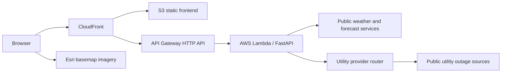

# Weather & Power

A serverless weather-and-power situational-awareness application that combines current weather, time-aware forecast maps, hazard context, and normalized public utility-outage information in one operational view.

**Live demo:** https://wnp.subrealstudios.com/  
**About the project:** https://wnp.subrealstudios.com/about.html

The project is built as a public portfolio application. Committed site records are synthetic demonstration locations, while weather and utility context is derived from public external sources.

## Table of Contents

- [Overview](#overview)
- [What the Application Does](#what-the-application-does)
- [Architecture](#architecture)
- [Reliability and Security](#reliability-and-security)
- [Provider Coverage](#provider-coverage)
- [Public Demo Data](#public-demo-data)
- [Local Development](#local-development)
- [Testing and CI](#testing-and-ci)
- [Deployment](#deployment)
- [Known Limitations](#known-limitations)
- [License](#license)

## Overview

Weather and utility systems expose different data formats, timing models, and failure modes. Weather & Power normalizes those differences behind one FastAPI contract and presents the resulting information through a map-centered operational dashboard.

The engineering focus is not simply rendering a weather page. The application demonstrates:

- integration of heterogeneous public data sources;
- normalization of multiple utility-outage platforms;
- time-aware forecast and GIS visualization;
- partial-failure handling when external systems are slow or unavailable;
- serverless AWS delivery;
- publication-safe synthetic portfolio data;
- CI/CD using GitHub Actions and AWS OIDC;
- bounded external-network and dependency controls.

## What the Application Does

### Weather and forecast context

- Current weather observations with observation time.
- Next-24-hours hourly outlook and temperature trend.
- Time-aware forecast map layers for:
  - Weather
  - Temperature
  - Precipitation probability
  - Wind speed
  - Hazards
- Forecast-valid-time timeline with current/previous/next controls.
- Active alert context and longer-duration forecast hazard guidance.
- Source-derived forecast legends.

### Power and site context

- Public utility-provider routing based on the selected demonstration location.
- Normalized nearby-outage information across different provider platforms.
- Customers-out, distance, and restoration-estimate presentation when available.
- Direct links to the selected site in Google Maps and the provider's public outage map.
- State-aware freshness messaging:
  - **LIVE LOOKUP** for a successful provider lookup;
  - **RECENT RESULT** when a recent cached result is used after a live timeout;
  - **UNAVAILABLE** when the provider result cannot be obtained.

### Location workflow

Visitors can select a demonstration location by:

- searching by city or location name;
- choosing a search suggestion;
- clicking a demonstration-site pin on the map;
- entering valid latitude/longitude coordinates.

Internal synthetic site IDs remain deterministic lookup keys, but the public experience is intentionally location-first.

## Architecture



### Request flow

1. **CloudFront** presents one public application hostname.
2. Static HTML, CSS, JavaScript, locally hosted icons, and vendored Leaflet assets are served from **Amazon S3**.
3. Requests under `/api/*` route through CloudFront to **API Gateway** and **AWS Lambda**.
4. The FastAPI backend validates input and calls guarded public weather/forecast or utility-provider integrations.
5. Provider-specific outage data is normalized into a common power-status model before it reaches the frontend.
6. Esri basemap/reference tiles are the intentionally allowed direct browser-side external imagery dependency.

### Backend

- FastAPI
- Mangum ASGI-to-Lambda adapter
- Python 3.12
- AWS Lambda
- API Gateway HTTP API
- provider-specific adapters behind a normalized routing layer
- bounded outbound concurrency and hostname allowlisting

### Frontend

- static HTML/CSS/JavaScript
- Leaflet 1.9.4 vendored locally
- responsive map-centered dashboard
- locally hosted weather/UI icons
- same-origin application API calls

## Reliability and Security

The application is designed to degrade individual integrations instead of failing the entire status view.

### Reliability controls

- Weather and power work execute concurrently under separate response budgets.
- Provider-specific calls use bounded timeouts.
- Recent provider failures are temporarily suppressed to avoid repeatedly hammering a degraded upstream.
- A recent successful power result can be used as a timeout fallback.
- Forecast valid times, legends, and point-hazard metadata use dedicated short-lived caches.
- Current weather/status application-level caching defaults to disabled in favor of fresh lookups.
- Weather or power failure can degrade independently without destroying the other component.

### Security and supply-chain controls

- explicit outbound hostname allowlist;
- TLS verification enabled by default;
- bounded query, coordinates, forecast layer, WMS, and utility inputs;
- API Gateway throttling;
- generic client-facing error handling;
- Content Security Policy and browser security headers;
- GitHub Actions pinned to immutable commit SHAs;
- exact Python dependency pins with `pip-audit`;
- locally vendored Leaflet runtime with provenance, license, and Git-blob integrity checks;
- publication-safety CI scanning;
- GitHub Actions deployment through AWS OIDC instead of stored long-lived AWS access keys.

The in-process FastAPI token bucket is a best-effort secondary control. API Gateway throttling is the durable infrastructure-level request throttle.

## Provider Coverage

The current application contains adapters for these public utility/provider families:

| Utility key | Provider |
| --- | --- |
| `OGE` | OG&E |
| `PSO` | Public Service Company of Oklahoma |
| `EVERGY` | Evergy |
| `ONCOR` | Oncor |
| `AUSTIN` | Austin Energy |
| `PEC` | Pedernales Electric Cooperative |
| `AEP` | AEP Texas |
| `CENTERPOINT` | CenterPoint Energy |
| `EPE` | El Paso Electric |
| `CITY_OF_CONCORDIA_ELECTRIC` | Concordia Electric |
| `PRAIRIE_LAND_ELECTRIC` | Prairie Land Electric Cooperative |
| `NINNESCAH_RURAL_ELECTRIC` | Ninnescah Rural Electric Cooperative |

Third-party outage systems can change independently of this project. Individual adapters may therefore require maintenance over time, and provider availability or restoration estimates should be treated as advisory.

## Public Demo Data

`app/data/sites.json` contains synthetic demonstration locations rather than operational facilities.

The public repository intentionally avoids committing:

- private facility addresses;
- internal infrastructure details;
- contact information;
- organization-specific network information;
- populated secret/configuration files.

The synthetic locations preserve realistic routing, provider, map, and card behavior without publishing private operational data.

## Local Development

Python 3.12 is the target backend runtime.

### Linux/macOS

```bash
python -m venv .venv
source .venv/bin/activate
python -m pip install --upgrade pip
python -m pip install -r requirements.txt -r requirements-dev.txt
PYTHONPATH=. pytest -q tests
uvicorn app.api:app --reload
```

### Windows PowerShell

```powershell
python -m venv .venv
.\.venv\Scripts\Activate.ps1
python -m pip install --upgrade pip
python -m pip install -r requirements.txt -r requirements-dev.txt
$env:PYTHONPATH = "."
pytest -q tests
uvicorn app.api:app --reload
```

Health check:

```text
GET /healthz
```

### Optional El Paso Electric configuration

The El Paso Electric adapter does not contain embedded credential-like defaults. If that provider is enabled in another deployment, supply:

```text
EPE_API_KEY
EPE_ENCRYPTION_KEY
```

`.env.example` documents the variable names with blank values. Do not commit populated `.env` files.

## Testing and CI

**Portfolio CI** runs for pull requests to `main` and can also be started manually.

It validates:

1. dependency installation;
2. runtime dependency imports;
3. Python compilation and targeted Ruff checks;
4. frontend JavaScript and UI contract checks;
5. vendored Leaflet version/license/integrity assertions;
6. the pytest suite;
7. `pip-audit`;
8. publication-safety scanning.

The repository also protects customer-facing behavior with contract checks for important map, forecast, card, dependency, and UI requirements.

## Deployment

Production publication is intentionally manual.

### Full application deploy

**Deploy Weather-and-Power App (SAM)** performs:

```text
Manual workflow dispatch
    -> validation/tests/dependency audit
    -> AWS OIDC authentication
    -> SAM build / validate / deploy
    -> S3 frontend sync
    -> CloudFront invalidation
```

Use this workflow when backend code, infrastructure, or backend dependencies change.

### Frontend-only deploy

**Deploy Weather-and-Power Frontend Only** performs:

```text
Manual workflow dispatch
    -> frontend validation
    -> AWS OIDC authentication
    -> S3 frontend sync
    -> CloudFront invalidation
```

Use this workflow for HTML/CSS/JavaScript/static-asset changes that do not require Lambda or CloudFormation changes.

Both deployment workflows share one concurrency group so a frontend-only release cannot race a full application deployment.

### Runtime defaults

- API Gateway throttle: **4 requests/second**
- API Gateway burst: **8 requests**
- Lambda timeout: **30 seconds**
- Lambda memory: **1024 MB**

## Known Limitations

- Public weather and utility systems can change independently of this repository.
- Utility restoration estimates and outage availability vary by provider.
- Forecast hazards and active warnings are different data concepts and should not be interpreted as interchangeable.
- The in-process application rate limiter is not a globally distributed throttle.
- Mobile layout is supported responsively, but the product is optimized primarily for a desktop operational dashboard.
- The application is a public portfolio implementation, not an authoritative emergency-management or utility operations system.

## License

This project is licensed under the **GNU General Public License v3.0 (GPL-3.0)**.

See [LICENSE](LICENSE) for the full license text.

Third-party frontend assets retain their own applicable licenses and notices under the repository's static/vendor asset directories.
